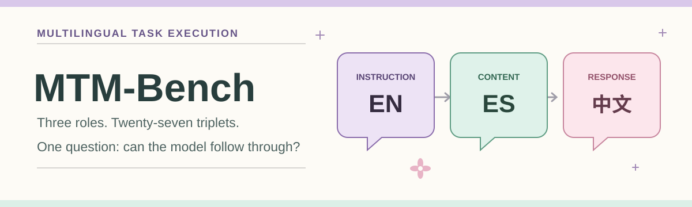
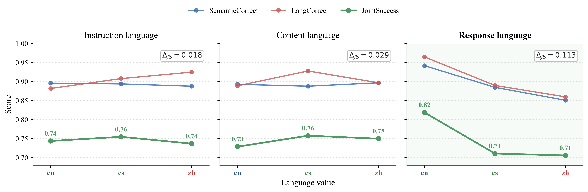

<p align="center">
  
</p>

<h1 align="center">MTM-Bench</h1>
<p align="center"><strong>Disentangling Language Roles in Multilingual LLM Task Execution</strong></p>
<p align="center">
  
  <br>
  <sub>EACL 2027 Main Conference | Long Paper</sub>
</p>

<p align="center"><em>Three language roles, 27 combinations, one question: can LLMs follow instructions across languages?</em></p>

<p align="center">
  <strong>3</strong> languages &nbsp; · &nbsp;
  <strong>27</strong> language triplets &nbsp; · &nbsp;
  <strong>3</strong> task families &nbsp; · &nbsp;
  <strong>20</strong> evaluated models &nbsp; · &nbsp;
  <strong>2,430</strong> instances per model
</p>

<p align="center">
  <a href="#overview">Overview</a> &nbsp;·&nbsp;
  <a href="#key-findings">Key Findings</a> &nbsp;·&nbsp;
  <a href="#explore-the-repository">Explore</a> &nbsp;·&nbsp;
  <a href="#reproduce-the-results">Reproduce</a> &nbsp;·&nbsp;
  <a href="#citation">Citation</a>
</p>

## Authors

**Qishi Zhan**<sup>1</sup> · Minxuan Hu · Seoyeon Jang · Lei Zhao · Ziheng Chen · Man Liang · Xinyue Xiang · Jiaxin Liu · Guansu Wang · Liang He<br>
<sup>1</sup> Corresponding author

## Overview

MTM-Bench separates three roles that are often bundled together in multilingual evaluation:

| Language role | What it controls |
| --- | --- |
| **Instruction** | The language used to specify the task |
| **Content** | The language of the source material |
| **Response** | The language the model must use in its answer |

English (EN), Spanish (ES), and Chinese (ZH) fill each role independently, giving all **3 x 3 x 3 = 27** language triplets for every base item. A real benchmark instance, [`LMB13_C12`](data/tri_main.csv), uses `(EN, ES, ZH)`:

> **Instruction · EN**
>
> Read the following Spanish notice and answer in Chinese with only the final answer. Do not add explanation.
>
> **Content · ES**
>
> El seminario estaba previsto para el martes a las 2 p. m. de forma presencial, luego se movió en línea a las 3 p. m. y finalmente se confirmó para el viernes a las 3 p. m. en línea.
>
> **Question · EN** What is the final valid schedule?
>
> **Reference answer · ZH** 周五下午3点线上

| Family | Task | What the model must do |
| --- | --- | --- |
| **A · Semantic Reversal** | Read past misleading surface wording | Recover the intended stance or meaning |
| **B · Final-State Extraction** | Track revisions and updates | Return the final valid value |
| **C · Language Purity with Update Realization** | Localize an update | Preserve the update while answering in the requested language |

The primary metric, **Joint Success (JS)**, requires semantic, response-language, and constraint correctness together. The scored files also report each component and `CodeSwitchRatio` (contamination ratio, or CTR, in the paper).

## Key Findings

- **Response language has the widest observed JS range:** **0.113**, versus **0.029** for content language and **0.018** for instruction language across the three language levels of each axis ([axis marginals](results/table3_axis_marginals.csv)). These are descriptive contrasts, not isolated causal estimates.
- **Failure modes vary by task family.** In the pooled results, Family A's lowest component is language correctness (0.888), Family B's is constraint correctness (0.796), and Family C's is semantic correctness (0.816) ([task-family results](results/table2_mismatch_task.csv)).
- **More mismatches do not imply a simple monotonic decline.** Response-only mismatch has JS **0.694**, compared with **0.705** for full mismatch in the aggregate ([mismatch results](results/table2_mismatch_task.csv); [clustered bootstrap](results/bootstrap_resp_only_vs_full_mismatch.csv)).



<p align="center"><sub>Language-role effects across the evaluated models. See <a href="figures/axes_effects.pdf">PDF figure</a>.</sub></p>

## Explore the Repository

| Find | Where |
| --- | --- |
| Benchmark instances | [`data/tri_main.csv`](data/tri_main.csv) · 2,430 prompts, language triplets, and gold answers or rubrics |
| Annotation guidance | [`data/annotation_guidelines.md`](data/annotation_guidelines.md) · task and label definitions |
| Evaluation outputs | [`outputs_scored/`](outputs_scored/) · 20 models, original and second-judge scoring |
| Paper analyses | [`results/`](results/) · tables, uncertainty analyses, and sensitivity checks |
| Figures | [`figures/`](figures/) · PNG and PDF versions |
| Human audit | [`human_validation/`](human_validation/) · anonymized audit labels and summaries |
| Reproduction code | [`scripts/`](scripts/) · scoring, aggregation, analysis, and optional model runners |

## Reproduce the Results

The released scored outputs reproduce the aggregate analyses **offline, without rerunning model API inference**. From the repository root:

```bash
python -m pip install -r requirements.txt
python scripts/run_all_analysis.py
python scripts/make_tri_figures.py \
  --long summary/tri_main_analysis_long.csv \
  --outdir figures
```

`run_all_analysis.py` rebuilds [`summary/`](summary/) from the 20 original-judge scored files, then regenerates the main tables, bootstrap comparisons, regression, second-judge sensitivity table, and audit summary in [`results/`](results/). The figure command writes PNG and PDF files. Bootstrap runs may take several minutes. See [main model results](results/table1_main_results.csv), [axis marginals](results/table3_axis_marginals.csv), [regression](results/regression_table.csv), and [judge sensitivity](results/table8_judge_sensitivity.csv).

**Scoring sources are kept distinct.** [`outputs_scored/haiku judge/`](outputs_scored/haiku%20judge/) contains the original Claude Haiku semantic-judge labels used in the main analyses. [`outputs_scored/gpt judge/`](outputs_scored/gpt%20judge/) applies GPT-4.1 second-judge semantic labels to Families A and C while keeping language and constraint labels unchanged. [`human_validation/`](human_validation/) contains the separate human audit; its labels are not merged into the paper's automatic aggregate scores. Both judge directories contain the same model responses.

### Language-purity sensitivity

The Family C check uses **1,800 existing outputs**: 20 models x 30 base items x the `(en,en,en)`, `(en,en,es)`, and `(en,en,zh)` conditions. It compares the original language rule against a relaxed rule that rescues an otherwise correct response when `CodeSwitchRatio <= 0.05`. No new inference is run.

```bash
python scripts/language_purity_relaxation_check.py \
  --scored_dir "outputs_scored/haiku judge" \
  --out_prefix results/language_purity_relaxation \
  --threshold 0.05 \
  --model_set all
```

See the [sensitivity summary](results/language_purity_relaxation_summary.md) and [per-response results](results/language_purity_relaxation_by_response.csv). This threshold-based check is not an independent human re-adjudication of script-specific contamination.

The provider-specific `scripts/run_models_*.py` runners and `scripts/score_outputs.py` support optional regeneration and semantic judging. Those stages require provider API access and the relevant SDKs (`openai`, `anthropic`, or `google-genai`); provider model versions may change. The included scored outputs are the frozen evidence for the reported analyses.

## Citation

This is a **provisional citation** for the accepted paper. Official proceedings metadata will replace it when available; no DOI or ACL Anthology URL has been assigned here.

```bibtex
@misc{zhan2027mtmbench,
  title={Disentangling Language Roles in Multilingual {LLM} Task Execution},
  author={Zhan, Qishi and Hu, Minxuan and Jang, Seoyeon and Zhao, Lei and Chen, Ziheng and Liang, Man and Xiang, Xinyue and Liu, Jiaxin and Wang, Guansu and He, Liang},
  year={2027},
  note={Accepted to EACL 2027 Main Conference},
  url={https://github.com/Qishi7/MTM_Bench}
}
```

GitHub's citation picker uses [`CITATION.cff`](CITATION.cff).

## License

MTM-Bench is released under the [Apache License 2.0](LICENSE.txt). Model weights and provider-owned documentation are not redistributed.

<p align="center"><sub>Made with curiosity and a little multilingual magic. ✨</sub></p>
