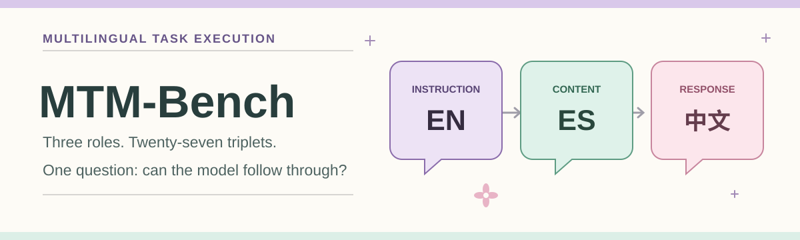
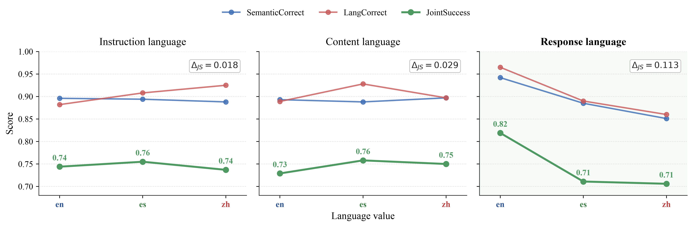
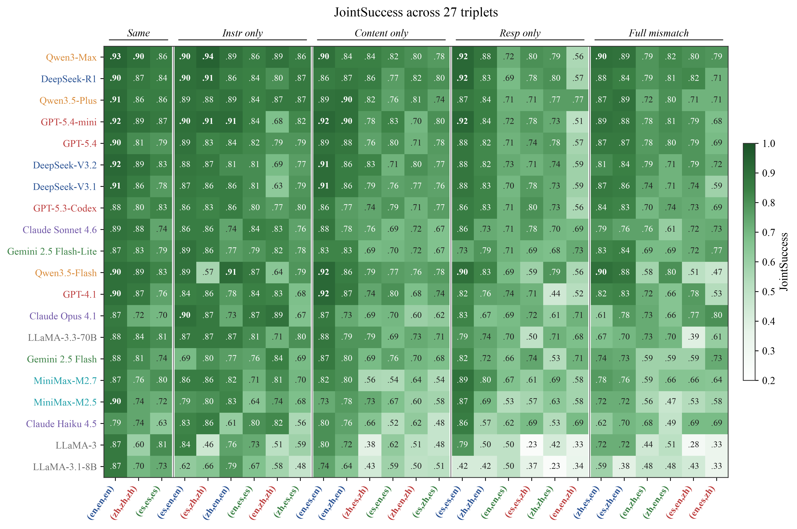

<p align="center">
  
</p>

<h1 align="center">MTM-Bench</h1>

<p align="center">
  <strong>Disentangling Language Roles in Multilingual LLM Task Execution</strong>
</p>

<p align="center">
  
</p>

<p align="center">
  <a href="https://arxiv.org/abs/2605.27649"><strong>Paper</strong></a> &nbsp;·&nbsp;
  <a href="data/tri_main.csv"><strong>Dataset</strong></a> &nbsp;·&nbsp;
  <a href="scripts/"><strong>Code</strong></a> &nbsp;·&nbsp;
  <a href="#citation"><strong>Citation</strong></a>
</p>

<table align="center">
  <thead>
    <tr>
      <th align="center">Languages</th>
      <th align="center">Language Triplets</th>
      <th align="center">Task Families</th>
      <th align="center">Models</th>
      <th align="center">Instances per Model</th>
    </tr>
  </thead>
  <tbody>
    <tr>
      <td align="center"><strong>3</strong></td>
      <td align="center"><strong>27</strong></td>
      <td align="center"><strong>3</strong></td>
      <td align="center"><strong>20</strong></td>
      <td align="center"><strong>2,430</strong></td>
    </tr>
  </tbody>
</table>

<p align="center">
  <a href="#overview">Overview</a> &nbsp;·&nbsp;
  <a href="#key-findings">Key Findings</a> &nbsp;·&nbsp;
  <a href="#model-leaderboard">Leaderboard</a> &nbsp;·&nbsp;
  <a href="#explore-the-repository">Repository</a> &nbsp;·&nbsp;
  <a href="#reproduce-the-results">Reproduce</a>
</p>

## Overview

MTM-Bench separates three roles that are often bundled together in multilingual evaluation:

| Language role | What it controls |
| --- | --- |
| **Instruction** | The language used to specify the task |
| **Content** | The language of the source material |
| **Response** | The language the model must use in its answer |

English (EN), Spanish (ES), and Chinese (ZH) fill each role independently, giving all **3 x 3 x 3 = 27** language triplets for every base item.

### Benchmark example

A real benchmark instance, [`LMB13_C12`](data/tri_main.csv), uses `(EN, ES, ZH)`:

> **Instruction · EN**
>
> Read the following Spanish notice and answer in Chinese with only the final answer. Do not add explanation.
>
> **Content · ES**
>
> El seminario estaba previsto para el martes a las 2 p. m. de forma presencial, luego se movió en línea a las 3 p. m. y finalmente se confirmó para el viernes a las 3 p. m. en línea.
>
> **Question · EN** What is the final valid schedule?
>
> **Reference answer · ZH** 周五下午3点线上

### Task families

| Family | Task | What the model must do |
| --- | --- | --- |
| **A · Semantic Reversal** | Read past misleading surface wording | Recover the intended stance or meaning |
| **B · Final-State Extraction** | Track revisions and updates | Return the final valid value |
| **C · Language Purity with Update Realization** | Localize an update | Preserve the update while answering in the requested language |

The primary metric, **Joint Success (JS)**, requires semantic, response-language, and constraint correctness together. The scored files also report each component and `CodeSwitchRatio` (contamination ratio, or CTR, in the paper).

## Key Findings

### 1. Response language is the dominant axis of variation

Across the three language levels of each role, response language has the widest observed Joint Success range.

| Language role | JS range |
| :--- | ---: |
| **Response** | **0.113** |
| Content | 0.029 |
| Instruction | 0.018 |

These are descriptive contrasts within the evaluated benchmark, not isolated causal estimates. See the [axis marginals](results/table3_axis_marginals.csv).

<p align="center">
  
  <br>
  <sub>Marginal language-role effects across 20 models. <a href="figures/axes_effects.pdf">View PDF</a>.</sub>
</p>

### 2. Different task families have different failure modes

The lowest-scoring component in each family's pooled results highlights a different measured bottleneck.

| Task family | Lowest-scoring component | Score |
| :--- | :--- | ---: |
| A · Semantic Reversal | Language correctness | 0.888 |
| B · Final-State Extraction | Constraint correctness | 0.796 |
| C · Language Purity with Update Realization | Semantic correctness | 0.816 |

See the [task-family results](results/table2_mismatch_task.csv) and [component failure profiles](figures/failure_profile.png).

### 3. Mismatch count alone does not determine difficulty

| Mismatch class | Joint Success |
| :--- | ---: |
| Response only | 0.694 |
| Full mismatch | 0.705 |

In the aggregate, full mismatch does not score below response-only mismatch. This descriptive comparison does not identify a causal benefit from additional mismatches. See the [mismatch results](results/table2_mismatch_task.csv) and [item-clustered bootstrap](results/bootstrap_resp_only_vs_full_mismatch.csv).

## Model Leaderboard

Top three models by Joint Success under the paper's original automatic scoring protocol.

| Rank | Model | Joint Success |
| :---: | :--- | ---: |
| 1 | **Qwen3-Max** | **0.840** |
| 2 | DeepSeek-R1 | 0.822 |
| 3 | Qwen3.5-Plus | 0.820 |

[View the full results for all 20 models →](results/table1_main_results.csv)

Scores are displayed to three decimal places, matching the paper.

<details>
<summary><strong>Explore all 27 language triplets</strong></summary>

<p align="center">
  
  <br>
  <sub>Joint Success by model and language triplet. <a href="figures/triplet_heatmap.pdf">View PDF</a>.</sub>
</p>

</details>

## Explore the Repository

| Find | Where |
| --- | --- |
| Benchmark instances | [`data/tri_main.csv`](data/tri_main.csv) · 2,430 prompts, language triplets, and gold answers or rubrics |
| Annotation guidance | [`data/annotation_guidelines.md`](data/annotation_guidelines.md) · task and label definitions |
| Evaluation outputs | [`outputs_scored/`](outputs_scored/) · 20 models, original and second-judge scoring |
| Paper analyses | [`results/`](results/) · tables, uncertainty analyses, and sensitivity checks |
| Figures | [`figures/`](figures/) · PNG and PDF versions |
| Human audit | [`human_validation/`](human_validation/) · anonymized audit labels and summaries |
| Reproduction code | [`scripts/`](scripts/) · scoring, aggregation, analysis, and optional model runners |

## Reproduce the Results

The released scored outputs reproduce the aggregate analyses **offline, without rerunning model API inference**. From the repository root:

```bash
python -m pip install -r requirements.txt
python scripts/run_all_analysis.py
python scripts/make_tri_figures.py \
  --long summary/tri_main_analysis_long.csv \
  --outdir figures
```

`run_all_analysis.py` rebuilds [`summary/`](summary/) from the 20 original-judge scored files, then regenerates the main tables, bootstrap comparisons, regression, second-judge sensitivity table, and audit summary in [`results/`](results/). The figure command writes PNG and PDF files. Bootstrap runs may take several minutes. See [main model results](results/table1_main_results.csv), [axis marginals](results/table3_axis_marginals.csv), [regression](results/regression_table.csv), and [judge sensitivity](results/table8_judge_sensitivity.csv).

**Scoring sources are kept distinct.** [`outputs_scored/haiku judge/`](outputs_scored/haiku%20judge/) contains the original Claude Haiku semantic-judge labels used in the main analyses. [`outputs_scored/gpt judge/`](outputs_scored/gpt%20judge/) applies GPT-4.1 second-judge semantic labels to Families A and C while keeping language and constraint labels unchanged. [`human_validation/`](human_validation/) contains the separate human audit; its labels are not merged into the paper's automatic aggregate scores. Both judge directories contain the same model responses.

### Language-purity sensitivity

The Family C check uses **1,800 existing outputs**: 20 models x 30 base items x the `(en,en,en)`, `(en,en,es)`, and `(en,en,zh)` conditions. It compares the original language rule against a relaxed rule that rescues an otherwise correct response when `CodeSwitchRatio <= 0.05`. No new inference is run.

```bash
python scripts/language_purity_relaxation_check.py \
  --scored_dir "outputs_scored/haiku judge" \
  --out_prefix results/language_purity_relaxation \
  --threshold 0.05 \
  --model_set all
```

See the [sensitivity summary](results/language_purity_relaxation_summary.md) and [per-response results](results/language_purity_relaxation_by_response.csv). This threshold-based check is not an independent human re-adjudication of script-specific contamination.

The provider-specific `scripts/run_models_*.py` runners and `scripts/score_outputs.py` support optional regeneration and semantic judging. Those stages require provider API access and the relevant SDKs (`openai`, `anthropic`, or `google-genai`); provider model versions may change. The included scored outputs are the frozen evidence for the reported analyses.

## Citation

The [2026 arXiv preprint](https://arxiv.org/abs/2605.27649) is accepted to EACL 2027 Main Conference. Proceedings metadata will replace this citation when available.

```bibtex
@misc{zhan2026disentanglinglanguagerolesmultilingual,
  title={Disentangling Language Roles in Multilingual LLM Task Execution},
  author={Qishi Zhan and Minxuan Hu and Seoyeon Jang and Lei Zhao and Ziheng Chen and Man Liang and Xinyue Xiang and Jiaxin Liu and Guansu Wang and Liang He},
  year={2026},
  eprint={2605.27649},
  archivePrefix={arXiv},
  primaryClass={cs.CL},
  url={https://arxiv.org/abs/2605.27649}
}
```

GitHub's citation picker uses [`CITATION.cff`](CITATION.cff).

## License

MTM-Bench is released under the [Apache License 2.0](LICENSE.txt). Model weights and provider-owned documentation are not redistributed.
